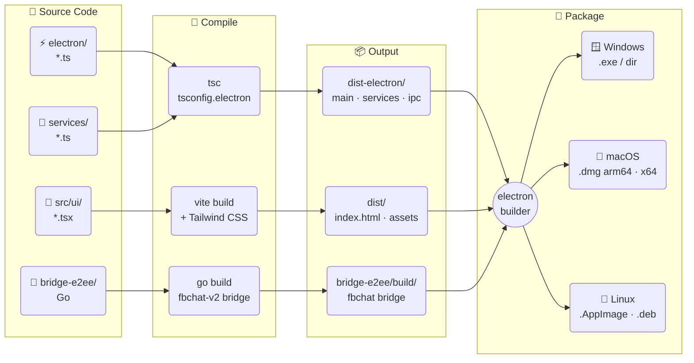
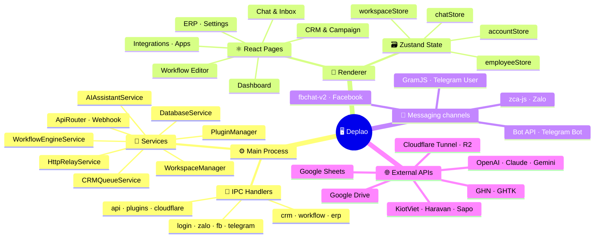
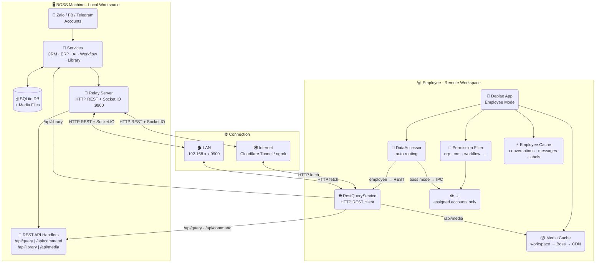
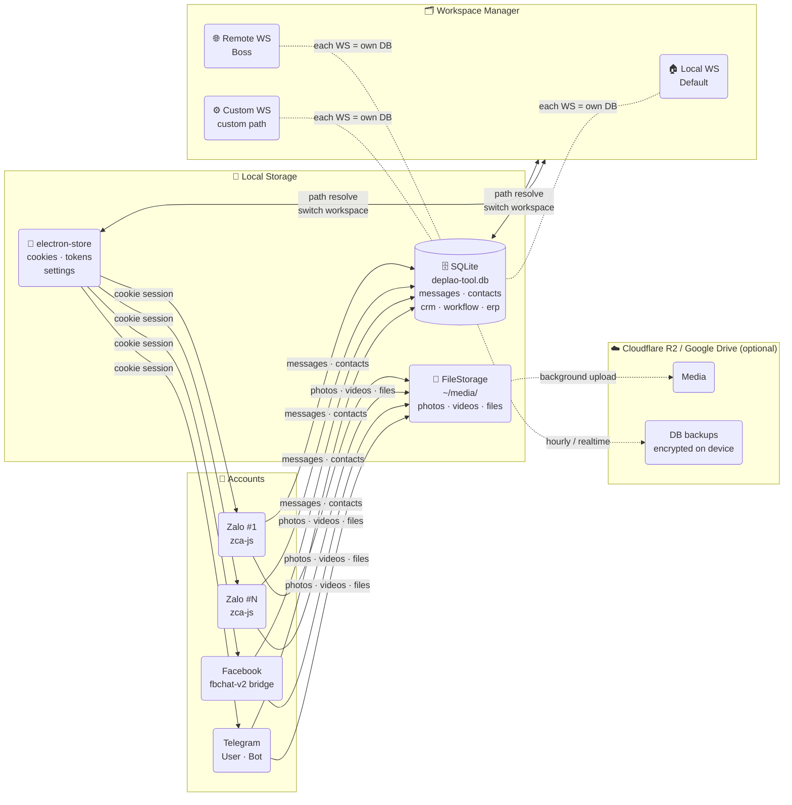

<div align="center">


# Deplao

**Desktop app for managing multiple Zalo, Facebook & Telegram accounts**
CRM · Marketing · ERP · POS · Workflow · AI Assistant — all in one unified workspace

[🌐 Website](https://deplaoapp.com/) · [🇻🇳 Tiếng Việt](./README.md)


</div>

<p align="center">
  <a href="#download">📥 Download</a> &nbsp;|&nbsp;
  <a href="#tech-stack">🛠️ Tech Stack</a> &nbsp;|&nbsp;
  <a href="#installation">📦 Install</a> &nbsp;|&nbsp;
  <a href="#public-api">🌐 Public API</a> &nbsp;|&nbsp;
  <a href="#features">✨ Features</a> &nbsp;|&nbsp;
  <a href="#security">🔒 Security</a> &nbsp;|&nbsp;
  <a href="#license">📝 MIT</a> &nbsp;|&nbsp;
  <a href="#contact">📞 Contact</a>
</p>

---

<a id="download"></a>

## ⬇️ Download

<table>
<tr>
<td align="center" width="50%">

<a href="https://github.com/babyvibe/deplao-builder/releases/latest/download/Deplao-Setup-26.10.4.exe">

</a>

<big><strong>Deplao-Setup-26.10.4.exe</strong></big>

</td>
<td align="center" width="50%">

<a href="https://github.com/babyvibe/deplao-builder/releases/latest/download/Deplao-26.10.4-arm64.dmg">

</a>

<big><strong>Deplao-26.10.4-arm64.dmg</strong></big>

</td>
</tr>
<tr>
<td align="center" width="50%">

<a href="https://github.com/babyvibe/deplao-builder/releases/latest/download/Deplao-26.10.4.AppImage">

</a>

<big><strong>Deplao-26.10.4.AppImage</strong></big><br>
<big>works on any distro - <code>chmod +x</code> & run</big>

</td>
<td align="center" width="50%">

<a href="https://github.com/babyvibe/deplao-builder/releases/latest/download/Deplao-26.10.4.dmg">

</a>

<big><strong>Deplao-26.10.4.dmg</strong></big>

</td>
</tr>
</table>

<p align="center">
👉 <strong><a href="https://github.com/babyvibe/deplao-builder/releases">View all releases</a></strong>
</p>

<details>
<summary>⚠️ Security warning on first launch (blocked by Windows / macOS / Linux)</summary>

Deplao is not code-signed (we're bootstrapped), so your OS may show a warning when opening the installer.

---

### 🪟 Windows (.exe)

Windows may show **"Windows protected your PC"**:

👉 How to proceed:
1. Click **More info**
2. Click **Run anyway**

---

### 🍎 macOS (.dmg)

macOS may show **"cannot be opened because it is from an unidentified developer"**

👉 How to proceed:

**Option 1:**
- Right-click the file → **Open**
- Click **Open** again

**Option 2 (if still blocked):**
1. Go to **System Settings → Privacy & Security**
2. Scroll down to Security
3. Click **Open Anyway**

---

### 🐧 Ubuntu Linux (.AppImage)

After downloading the `.AppImage` file:

```bash
chmod +x Deplao-*.AppImage
./Deplao-*.AppImage
```

> If you get "FUSE: fuse2 not available", install `libfuse2`:
> ```bash
> sudo apt install libfuse2
> ```

Or install the `.deb` package:
```bash
sudo dpkg -i Deplao_*_amd64.deb
```

</details>

<p align="center">
  
</p>

<a id="tech-stack"></a>

## 🛠️ Tech Stack

Deplao is built on the following core technologies:

- **Messaging libraries:** zca-js (Zalo), fbchat-v2 (Facebook Messenger, a Go bridge based on mautrix-meta), GramJS (Telegram User), Telegram Bot API
- **AI Gateway:** 9router, OpenRouter or direct OpenAI, Claude, Gemini...
- **Languages:** TypeScript, JavaScript, Go, SQL, HTML, CSS
- **Desktop:** Electron, React, Vite
- **UI:** Tailwind CSS, PostCSS
- **Local storage:** SQLite via `better-sqlite3`
- **State & UI specialized:** Zustand, React Flow, Recharts, Quill
- **Realtime & API:** Socket.IO, REST API v1 + OpenAPI, webhooks
- **Cloud (optional):** Cloudflare Tunnel, Cloudflare R2, Google Drive API (Google One)
- **Integrations & automation:** Axios, Google APIs / Google Sheets, node-cron, Telegram Bot API, etc.

---

<a id="installation"></a>

## Installation

<details open>
<summary>🛠️ Build from source</summary>

### Requirements

- Windows 10/11, macOS (Apple Silicon / Intel), or Ubuntu 20.04+
- Node.js 18+ recommended
- npm 9+

### Install dependencies

```powershell
npm install --legacy-peer-deps
```

### Run in development mode

```powershell
npm run dev
```

### Build production app

```powershell
npm run production
```

### Local data

- App data is stored in local SQLite
- Storage directory can be changed in `Settings`

</details>

## 🗺️ Architecture & Flow Diagrams

---

### 1️⃣ Build Pipeline



---

### 2️⃣ Runtime Architecture



---

### 3️⃣ Boss ↔ Employee Model (REST API)



> Employees fetch data through the **REST API** (HTTP fetch → Boss) instead of syncing the whole DB. DataAccessor routes automatically: standalone/boss → direct IPC, employee → RestQueryService → Boss. Socket.IO carries realtime events, with automatic reconnects and missed-event catch-up. Media is cached locally with a workspace → Boss → CDN cascade. An employee's Facebook / Telegram actions run through the Boss machine. Remote employees connect through a fixed Internet address (Cloudflare Tunnel) or ngrok.

---

### 4️⃣ Multi-account & Local Storage



> Each **Workspace** has its own DB + media folder — switch or move to another drive without losing data. Media and the DB can also be backed up to your own Cloudflare R2 or Google Drive (Google One) and restored on a new machine.

---


<a id="public-api"></a>

## 🌐 Public API & Extension Apps

Deplao ships a **Public API v1** with ~300 operations (accounts, Zalo / Facebook / Telegram chat, groups, labels, contacts, CRM, workflows, integrations, ERP, AI, reports, media, employees) to connect your website, n8n, sales software or your own systems. The API runs **on the machine where Deplao is installed** (default port `9900`) and is **off by default** until you enable it. Every call goes through the app's normal flow: a message sent via the API shows up in the chat window, is saved to the DB and triggers workflows just like one you send yourself.

### Quick start

1. Open **Công cụ (Tools) → Ứng dụng, API & Webhook → API** and turn on the **API server**.
2. Click **Tạo API key** (Create API key), choose scopes and allowed accounts. The `dpk_...` key is shown only once.
3. Try it:

```bash
curl -H "Authorization: Bearer dpk_xxx" http://127.0.0.1:9900/api/v1/accounts
```

- Full docs (guides, endpoint list, "Try it" button, curl commands): `http://127.0.0.1:9900/docs`
- OpenAPI for Postman / Insomnia / SDK generation: `http://127.0.0.1:9900/api/v1/openapi.json`
- Realtime events (Socket.IO, SSE, polling) and **outgoing webhooks** with HMAC signatures and retries
- Remote access (employees, incoming webhooks, payments): use the Internet address from **Settings → Internet & Đám mây**

### Build your own apps

Apps (plugins) run inside Deplao: their own page, chat side panels, composer buttons, settings, workflow nodes and schedules. Install from a zip file or a folder and review permissions before they run; an app can only call the API within the permissions you approved and on the accounts you granted. The toolkit lives in [`packages/`](./packages): the `@deplao/plugin-sdk` SDK and the `deplao-plugin` CLI.

```bash
node packages/plugin-cli/bin/deplao-plugin.js create my-app --runtime web
node packages/plugin-cli/bin/deplao-plugin.js validate my-app
node packages/plugin-cli/bin/deplao-plugin.js pack my-app --out my-app.zip
```

## 🚀 What is Deplao?

At a glance, Deplao is:

- **An operations hub**: multiple Zalo, Facebook, Telegram accounts, a unified inbox, quick replies, chat history sync
- **A customer management layer**: CRM, labels, interaction history, campaigns for friends and customers who have messaged you
- **An automation layer**: workflows, AI, triggers and actions running in the background
- **A business connection layer**: POS, shipping, payments, Public API, webhooks and your own apps
- **An internal management layer**: reports, ERP, permissions, employee workspaces, cloud backups

## ✨ Highlights

- 👤 **Multi-account Zalo, Facebook, Telegram Bot, Telegram User** - unlimited accounts, fast switching
- 💬 **Unified inbox** - merged mode consolidates conversations from multiple accounts into one view
- 📱 **Old message sync** - pull Zalo chat history from your phone into the app by time range; sync Facebook Messenger history by time range
- 👥 **CRM & Campaign** - contacts, labels, internal notes, re-engagement; campaigns for friends and customers who have messaged you, with a chat-style content preview and realtime stats
- ⚙️ **Workflow automation** - drag-and-drop Trigger → Node → Action or chat with the AI copilot to build flows, test them in Simulation mode, run 24/7 with no code
- 🤖 **AI Assistant** - reply suggestions, in-chat AI Q&A, message classification and 24/7 auto-replies
- 🔗 **External integrations** - POS, shipping, payments, Google Sheets, Telegram, Email, HTTP Request... usable in chat or workflows
- 🧩 **Apps & Public API** - ~300 APIs, webhooks, realtime events and your own apps running inside Deplao
- ☁️ **Internet & Cloud** - a fixed Internet address through your own Cloudflare; media plus encrypted DB backup + sync on Cloudflare R2 or Google Drive (Google One), with usage and estimated cost; restore to a new machine
- 📈 **Reports & analytics** - track messages, contacts, labels, employees, campaigns, workflows, AI
- 🗂️ **Internal ERP** - tasks, calendars, notes and team coordination within the same system
- 🧑‍💼 **Boss ↔ Employee workspaces** - connect via **LAN or the Internet**, automatic reconnects, two-way realtime sync, fine-grained permissions and per-employee performance tracking
- 🎨 **Light / Dark UI** - one color system and component set, a compact navigation bar with a "Tools" group
- 🔒 **Per-account proxy** - assign a dedicated proxy to each account before login
- 🔐 **Local-first data** - prioritizes data ownership and security on the user's machine


### Screenshots

Screens are ordered by real usage flow: dashboard → chat → CRM → workflow → integrations / reports / ERP → extension tools (demo data; the app UI is in Vietnamese).

<table>
  <tr>
    <td>
      
      <br />
      <sub><strong>Multi-account dashboard</strong></sub>
    </td>
    <td>
      
      <br />
      <sub><strong>Unified chat with AI reply suggestions</strong></sub>
    </td>
    <td>
      
      <br />
      <sub><strong>CRM & contacts</strong></sub>
    </td>
  </tr>
  <tr>
    <td>
      
      <br />
      <sub><strong>Campaigns for friends & customers</strong></sub>
    </td>
    <td>
      
      <br />
      <sub><strong>Workflow editor</strong></sub>
    </td>
    <td>
      
      <br />
      <sub><strong>Workflow details</strong></sub>
    </td>
  </tr>
  <tr>
    <td>
      
      <br />
      <sub><strong>Create workflows by talking to AI</strong></sub>
    </td>
    <td>
      
      <br />
      <sub><strong>POS, shipping & payment integrations</strong></sub>
    </td>
    <td>
      
      <br />
      <sub><strong>Reports & analytics</strong></sub>
    </td>
  </tr>
  <tr>
    <td>
      
      <br />
      <sub><strong>Employee management</strong></sub>
    </td>
    <td>
      
      <br />
      <sub><strong>Internal ERP</strong></sub>
    </td>
    <td>
      
      <br />
      <sub><strong>Apps, API & Webhook</strong></sub>
    </td>
  </tr>
  <tr>
    <td>
      
      <br />
      <sub><strong>Internet & Cloud (Cloudflare · Google Drive)</strong></sub>
    </td>
    <td>
      
      <br />
      <sub><strong>Sync old messages from your phone</strong></sub>
    </td>
  </tr>
</table>

## 🎯 Who is it for?

Deplao is a great fit for:

- Online shops and sales teams closing orders via Zalo, Facebook, Telegram
- Workflow automation and customer care, with campaigns for friends and customers who have messaged you
- SMEs needing multiple staff handling inboxes simultaneously
- Marketing agencies or freelancers managing multiple client accounts
- Spas, clinics, education, F&B and businesses requiring recurring customer care
- Teams wanting chat, CRM, workflow, AI and ERP in a single desktop app
- Developers who want to connect Zalo, Facebook, Telegram to their own systems via the API, webhooks or custom apps

<a id="features"></a>

## 🧩 Core feature groups

### 1) Multi-account & unified inbox
- Log in to multiple Zalo (personal / Business), Facebook, Telegram bot and Telegram user accounts
- Visual account management dashboard; re-login Facebook in place when the session expires
- Merge multiple accounts into one unified inbox
- Accent-insensitive search by name, nickname, phone number
- Quick filters: unread, labels (Local / Zalo) and channel
- Quick actions: create groups, join a group by link, add friends, add appointments and notes
- Bulk mark-as-read by the time of the last message (runs in the background), synced to Zalo, Telegram, Facebook
- Sync old Zalo messages from your phone by time range; sync Facebook Messenger history per account and time range
- Assign a dedicated proxy per account

### 2) Full-featured chat
- Send rich text, images, albums, videos, files, voice messages
- Send emoji, stickers, replies, member mentions, reactions
- Send polls, group notes, reminders, contact cards
- Quick messages: save message templates and trigger them by keyword
- Unlimited pinned messages, Starred messages, Zalo My Documents, media and file management
- Correct forwarding for every Zalo message type, date markers while scrolling, photo gallery
- Telegram: create groups / channels, group / channel management, contacts, call log, Sticker · GIF panel synced with your account

### 3) CRM & customer care
- Sync friends, joined groups and contact profiles
- Store phone number, gender, birthday, internal notes
- Two-way Zalo label sync and Local labels shared across accounts
- Filter contacts by multiple criteria for targeted outreach
- Send campaigns to friends and customers who have messaged you (messages, group invites) with realtime progress; chat-style content preview, send image first / text first or merge image + text

### 4) Workflow automation
- No-code drag-and-drop workflows with an auto-layout button
- Chat-style AI copilot to create and edit workflows from prompts (see section 7)
- Simulation mode to test runs without sending real messages
- Triggers: messages, labels, reactions, cron schedules, group events, webhooks...; filters by sender role, only when @mentioned
- Actions: send messages, images/files, find users, manage groups, mute, forward, recall...
- Integrations: logic, Google Sheets, AI, Telegram, Email, Notion and HTTP Request
- Execution history for easy debugging

### 5) Sales integrations
- POS: KiotViet, Haravan, Sapo, Nhanh.vn, Pancake POS
- Shipping: GHN, GHTK
- Payments: Sepay, Casso
- AI Assistant for reply suggestions and in-chat Q&A (see section 7)
- Combine into closed-loop sales and customer care workflows

### 6) Reports, ERP & employee management
- Reports: messages, contacts, campaigns, workflows, AI, employees
- Internal ERP: Tasks, Calendar, Notes; work alerts to employees via Zalo (new tasks, due soon, leave requests)
- Boss ↔ Employee model with module-level permissions; employees only see their assigned accounts
- Employees connect over LAN or the Internet, reconnect automatically, realtime sync including edits / deletes / reactions
- Track individual and team performance across time periods

### 7) 🤖 AI Assistant
- Smart reply suggestions in conversations
- Ask AI questions directly in the chat window
- Create and edit workflows with Vietnamese prompts through the AI copilot — no drag-and-drop needed
- Use AI nodes in workflows to build 24/7 auto-reply chatbots
- Multi-platform AI support: OpenAI, Claude, Gemini, DeepSeek, Grok, … and local AI gateways like 9Router, OpenRouter, etc.

### 8) 🧩 Apps, Public API & Webhook
- Public API v1 with ~300 operations, API keys scoped by permission / account / IP / expiry, request log
- Realtime events and signed outgoing webhooks, a docs page + OpenAPI
- Install or write your own apps that run inside Deplao, with an SDK and CLI (see [Public API](#public-api))

### 9) ☁️ Internet & Cloud (Cloudflare · Google Drive)
- One place to configure your Internet address (temporary address, automatic Cloudflare, ngrok, manual Cloudflare) for remote employees, webhooks and payments
- Choose where to store: Cloudflare R2 or Google Drive (Google One) — sign in to Google in your browser; Deplao only sees the files it created
- Store media on the chosen storage, fetch it back when local files are missing, optionally free up disk space
- Back up & sync the DB to the chosen storage, encrypted on your machine; restore to a new or standby machine
- Usage & cost: % of the free tier and billing thresholds, this month's estimated cost (R2), what counts as a write / read / download

<a id="security"></a>

## 🔒 Security & data

Deplao is designed to run locally on the user's machine:

- All messages, contacts, CRM data, settings and media are stored locally
- Zalo logs in with a QR code and no password is stored; login sessions (cookies, tokens) stay on the machine and are encrypted with the OS key (Zalo and Telegram sessions, bot tokens, Facebook cookies)
- Storage directory can be moved to another drive at any time
- The cloud is optional and uses your own Cloudflare / Google account (on Google Drive, Deplao only gets access to the files it created); DB backups are encrypted on the machine before upload
- The Public API is off by default, API keys are limited by permission, account and IP; apps run only within the permissions you approved
- Employees can only access their assigned accounts; locking an employee or changing their password revokes their session immediately
- Ideal for teams wanting tighter internal data control
- Deplao is a tool for managing your own accounts: follow the terms of Zalo, Facebook, Telegram and the personal data protection rules that apply to you; do not use it to send spam or collect data unlawfully

## 💻 Runtime requirements

- Stable 24/7 internet connection for conversation sync and automation
- Keep the app running if using workflows or team operations


---------------------------------------------------------------------------------------------------------------------------------------------

<a id="contact"></a>

## 📣 Contact & support

- Bug reports, feedback or support: 👉 [Open an issue](https://github.com/babyvibe/deplao-builder/issues)

## 🙏 Acknowledgements

Special thanks to the projects: zca-js, fbchat-v2 (mautrix-meta) & GramJS.

---

<a id="license"></a>

## 📝 License

Distributed under the **MIT** license.
See [LICENSE](LICENSE) for details.

---
