<div align="center">


# Deplao

**Phần mềm desktop quản lý tài khoản Zalo, Facebook & Telegram đa tài khoản**
Tích hợp CRM · MARKETING · ERP · POS · Workflow · Trợ lý AI - vận hành tập trung trong một app duy nhất

[🌐 Website](https://deplaoapp.com/) · [🇬🇧 English](./README.en.md)


</div>

<p align="center">
  <a href="#tai-xuong">📥 Tải xuống</a> &nbsp;|&nbsp;
  <a href="#cong-nghe">🛠️ Công nghệ</a> &nbsp;|&nbsp;
  <a href="#cai-dat">📦 Cài đặt</a> &nbsp;|&nbsp;
  <a href="#public-api">🌐 Public API</a> &nbsp;|&nbsp;
  <a href="#tinh-nang">✨ Tính năng</a> &nbsp;|&nbsp;
  <a href="#bao-mat">🔒 Bảo mật</a> &nbsp;|&nbsp;
  <a href="#giay-phep">📝 MIT</a> &nbsp;|&nbsp;
  <a href="#lien-he">📞 Liên hệ</a>
</p>

---

<a id="tai-xuong"></a>

## ⬇️ Tải xuống

<table>
<tr>
<td align="center" width="50%">

<a href="https://github.com/babyvibe/deplao-builder/releases/latest/download/Deplao-Setup-26.10.1.exe">

</a>

<big><strong>Deplao-Setup-26.10.1.exe</strong></big>

</td>
<td align="center" width="50%">

<a href="https://github.com/babyvibe/deplao-builder/releases/latest/download/Deplao-26.10.1-arm64.dmg">

</a>

<big><strong>Deplao-26.10.1-arm64.dmg</strong></big>

</td>
</tr>
<tr>
<td align="center" width="50%">

<a href="https://github.com/babyvibe/deplao-builder/releases/latest/download/Deplao-26.10.1.AppImage">

</a>

<big><strong>Deplao-26.10.1.AppImage</strong></big><br>
<big>chạy mọi distro - <code>chmod +x</code> là dùng được</big>

</td>
<td align="center" width="50%">

<a href="https://github.com/babyvibe/deplao-builder/releases/latest/download/Deplao-26.10.1.dmg">

</a>

<big><strong>Deplao-26.10.1.dmg</strong></big>

</td>
</tr>
</table>

<p align="center">
👉 <strong><a href="https://github.com/babyvibe/deplao-builder/releases">Xem tất cả phiên bản</a></strong>
</p>

<details>
<summary>⚠️ Lưu ý khi mở file cài đặt (bị chặn bởi Windows / macOS / Linux)</summary>

Do Deplao chưa được ký chứng chỉ (code signing) - nói thẳng ra là nghèo, nên hệ điều hành có thể hiển thị cảnh báo khi mở file. Bạn có thể làm theo hướng dẫn dưới đây:

---

### 🪟 Windows (.exe)

Khi mở file `.exe`, Windows có thể hiển thị cảnh báo **"Windows protected your PC"**:

👉 Cách xử lý:
1. Nhấn **More info**
2. Chọn **Run anyway**

---

### 🍎 macOS (.dmg)

Khi mở file `.dmg`, macOS có thể báo **"cannot be opened because it is from an unidentified developer"**

👉 Cách xử lý:

**Cách 1:**
- Chuột phải vào file → chọn **Open**
- Nhấn **Open** lần nữa

**Cách 2 (nếu vẫn bị chặn):**
1. Vào **System Settings → Privacy & Security**
2. Kéo xuống phần Security
3. Nhấn **Open Anyway**

---

### 🐧 Ubuntu Linux (.AppImage)

Sau khi tải file `.AppImage`:

```bash
chmod +x Deplao-*.AppImage
./Deplao-*.AppImage
```

> Nếu gặp lỗi "FUSE: fuse2 not available", cài `libfuse2`:
> ```bash
> sudo apt install libfuse2
> ```

Hoặc cài bản `.deb`:
```bash
sudo dpkg -i Deplao_*_amd64.deb
```

</details>

<p align="center">
  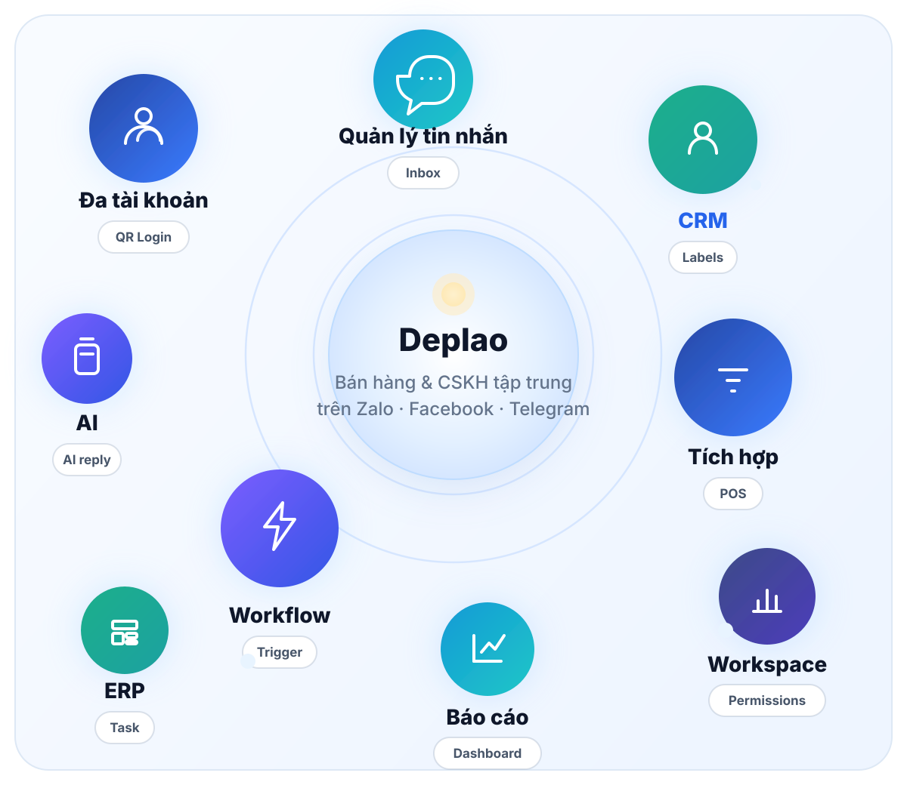
</p>

<a id="cong-nghe"></a>

## 🛠️ Công nghệ & ngôn ngữ sử dụng

Deplao hiện được xây dựng trên các công nghệ chính sau:

- **Thư viện kênh nhắn tin:** zca-js (Zalo), fbchat-v2 (Facebook Messenger, bridge Go dựa trên mautrix-meta), GramJS (Telegram User), Telegram Bot API
- **AI Gateway:** 9router, OpenRouter hoặc kết nối trực tiếp OpenAI, Claude, Gemini...
- **Ngôn ngữ:** TypeScript, JavaScript, Go, SQL, HTML, CSS
- **Ứng dụng desktop:** Electron, React, Vite
- **Giao diện:** Tailwind CSS, PostCSS
- **Lưu trữ dữ liệu cục bộ:** SQLite qua `better-sqlite3`
- **State & UI chuyên biệt:** Zustand, React Flow, Recharts, Quill
- **Realtime & API:** Socket.IO, REST API v1 + OpenAPI, Webhook
- **Đám mây (tuỳ chọn):** Cloudflare Tunnel, Cloudflare R2, Google Drive API (Google One)
- **Tích hợp & automation:** Axios, Google APIs / Google Sheets, node-cron, Telegram Bot API, v.v.

---


<a id="cai-dat"></a>

## Cài đặt

<details open>
<summary>🛠️ Tự build từ source</summary>

### Yêu cầu

- Windows 10/11, macOS (Apple Silicon / Intel), hoặc Ubuntu 20.04+
- Node.js 18+ khuyến nghị
- npm 9+

### Cài đặt

```powershell
npm install --legacy-peer-deps
```

### Chạy development

```powershell
npm run dev
```

### Build app

```powershell
npm run production
```

### Dữ liệu cục bộ

- Dữ liệu app dùng SQLite cục bộ
- Có thể đổi thư mục lưu trữ trong phần `Cài đặt`

</details>

## 🗺️ Sơ đồ kiến trúc & luồng hoạt động

---

### 1️⃣ Luồng Build

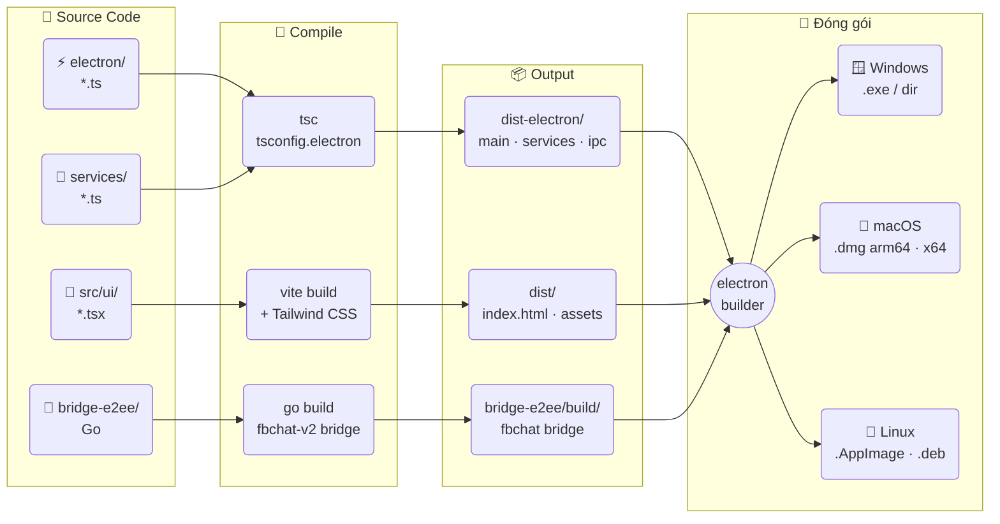

---

### 2️⃣ Kiến trúc Runtime

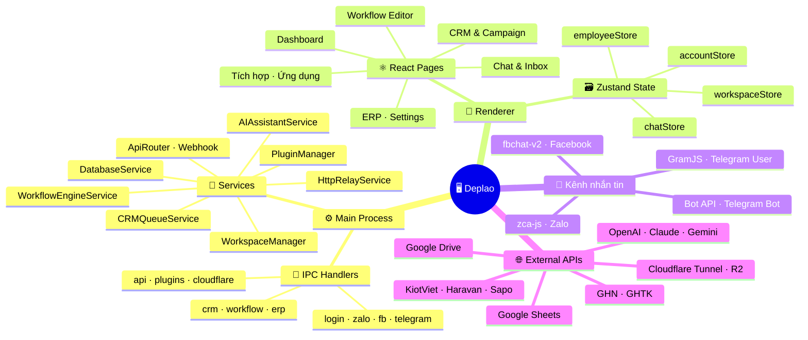

---

### 3️⃣ Mô hình Boss ↔ Nhân viên (REST API)

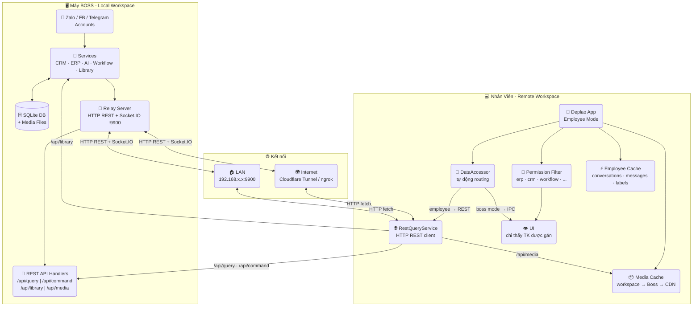

> Nhân viên gọi dữ liệu qua **REST API** (HTTP fetch → Boss) thay vì sync toàn bộ DB. DataAccessor tự động routing: standalone/boss → IPC trực tiếp, employee → RestQueryService → Boss. Socket.IO cho realtime event, tự kết nối lại và nhận bù sự kiện bị lỡ. Media được cache local với cascade workspace → Boss → CDN. Facebook / Telegram của nhân viên chạy qua máy Boss. Nhân viên ở xa kết nối qua địa chỉ Internet cố định (Cloudflare Tunnel) hoặc ngrok.

---

### 4️⃣ Đa tài khoản & Lưu trữ

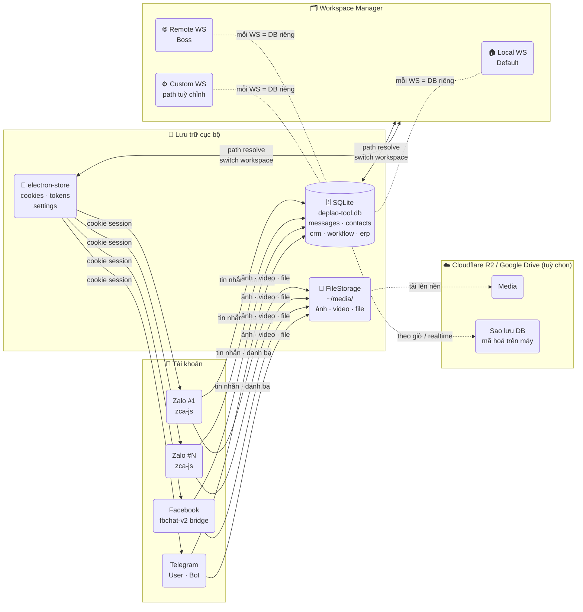

> Mỗi **Workspace** có DB + media folder độc lập - đổi hoặc di chuyển sang ổ đĩa khác không mất dữ liệu. Media và DB có thể sao lưu thêm lên Cloudflare R2 hoặc Google Drive (Google One) của chính bạn để khôi phục sang máy mới.

---


<a id="public-api"></a>

## 🌐 Public API & Ứng dụng mở rộng

Deplao có **Public API v1** với gần 300 thao tác (tài khoản, chat Zalo / Facebook / Telegram, nhóm, nhãn, danh bạ, CRM, workflow, tích hợp, ERP, AI, báo cáo, media, nhân viên) để kết nối website, n8n, phần mềm bán hàng hay hệ thống riêng của bạn. API chạy **ngay trên máy cài Deplao** (cổng mặc định `9900`) và **tắt sẵn** cho tới khi bạn bật. Mọi lời gọi đi qua đúng luồng của app: tin gửi bằng API vẫn hiện trong khung chat, lưu DB, kích hoạt workflow như khi bạn tự gửi.

### Bắt đầu nhanh

1. Mở **Công cụ → Ứng dụng, API & Webhook → API**, bật **API server**.
2. Bấm **Tạo API key**, chọn quyền (scope) và tài khoản được phép. Key `dpk_...` chỉ hiện một lần.
3. Gọi thử:

```bash
curl -H "Authorization: Bearer dpk_xxx" http://127.0.0.1:9900/api/v1/accounts
```

- Tài liệu đầy đủ (hướng dẫn, danh sách endpoint, nút "Thử gọi", lệnh curl): `http://127.0.0.1:9900/docs`
- OpenAPI cho Postman / Insomnia / sinh SDK: `http://127.0.0.1:9900/api/v1/openapi.json`
- Sự kiện realtime (Socket.IO, SSE, polling) và **webhook gửi ra** có chữ ký HMAC, tự thử lại
- Gọi từ xa (nhân viên, webhook nhận vào, thanh toán): dùng địa chỉ Internet ở **Cài đặt → Internet & Đám mây**

### Ứng dụng tự phát triển

Ứng dụng (plugin) chạy ngay trong Deplao: trang riêng, panel trong khung chat, nút ở ô soạn tin, cài đặt riêng, node workflow và lịch chạy. Cài từ file zip hoặc thư mục, duyệt quyền trước khi chạy; ứng dụng chỉ gọi được API trong phạm vi quyền đã duyệt và trên các tài khoản được cấp. Bộ công cụ nằm trong thư mục [`packages/`](./packages): SDK `@deplao/plugin-sdk` và CLI `deplao-plugin`.

```bash
node packages/plugin-cli/bin/deplao-plugin.js create my-app --runtime web
node packages/plugin-cli/bin/deplao-plugin.js validate my-app
node packages/plugin-cli/bin/deplao-plugin.js pack my-app --out my-app.zip
```

## 🚀 Deplao là gì?

Nếu nhìn nhanh, có thể hiểu Deplao là:

- **trung tâm vận hành**: nhiều tài khoản Zalo, Facebook, Telegram, inbox tập trung, trả lời nhanh, đồng bộ lịch sử chat
- **lớp quản lý khách hàng**: CRM, nhãn, lịch sử tương tác, chiến dịch gửi tin
- **lớp tự động hóa**: workflow, AI, trigger và action chạy nền
- **lớp kết nối kinh doanh**: POS, vận chuyển, thanh toán, Public API, webhook và ứng dụng tự phát triển
- **lớp quản trị nội bộ**: báo cáo, ERP, phân quyền, workspace nhân viên, sao lưu đám mây

## ✨ Điểm nổi bật

- 👤 **Đa tài khoản Zalo, Facebook, Telegram Bot, Telegram User** - đăng nhập không giới hạn tài khoản, chuyển đổi qua lại nhanh
- 💬 **Hộp thư tập trung** - chế độ gộp tài khoản giúp gom và xử lý hội thoại từ nhiều tài khoản trong một giao diện duy nhất
- 📱 **Đồng bộ tin nhắn cũ** - kéo lịch sử chat Zalo từ điện thoại về app theo khoảng thời gian; Facebook đồng bộ lịch sử Messenger theo khoảng thời gian
- 👥 **CRM & Campaign** - quản lý liên hệ, nhãn, ghi chú nội bộ, chăm sóc khách cũ. Quét thành viên nhóm ẩn, nhóm chưa tham gia để tìm khách mới; chiến dịch gửi tin xem trước nội dung như khung chat, thống kê realtime
- ⚙️ **Workflow tự động hóa** - kéo-thả Trigger → Node → Action hoặc trò chuyện với AI copilot để tạo quy trình, chạy thử ở chế độ Mô phỏng, chạy nền 24/7 không cần code
- 🤖 **AI Assistant** - hỗ trợ gợi ý câu trả lời, chat trực tiếp trong hội thoại. Còn giúp phân loại tin nhắn, trả lời khách hàng 24/7.
- 🔗 **Tích hợp ngoài** - POS, vận chuyển, thanh toán, Google Sheets, Telegram, Email, HTTP Request... Kết hợp sử dụng khi chat hoặc workflow
- 🧩 **Ứng dụng & Public API** - gần 300 API, webhook, sự kiện realtime và ứng dụng tự phát triển chạy ngay trong Deplao
- ☁️ **Internet & Đám mây** - địa chỉ Internet cố định qua Cloudflare của bạn; lưu media, sao lưu + đồng bộ DB đã mã hoá lên Cloudflare R2 hoặc Google Drive (Google One), xem mức dùng và phí ước tính; khôi phục sang máy mới
- 📈 **Báo cáo & phân tích** - theo dõi tin nhắn, liên hệ, nhãn, nhân viên, chiến dịch, workflow, AI.
- 🗂️ **ERP nội bộ** - task, lịch làm việc, notes và phối hợp vận hành nội bộ ngay trong cùng hệ thống
- 🧑‍💼 **Workspace boss ↔ nhân viên** - kết nối qua **LAN hoặc Internet**, tự kết nối lại, đồng bộ realtime hai chiều, phân quyền chi tiết và theo dõi hiệu suất từng nhân viên
- 🎨 **Giao diện Sáng / Tối** - bảng màu và bộ thành phần thống nhất, thanh điều hướng gọn với nhóm "Công cụ"
- 🔒 **Proxy per-account** - gán Proxy riêng cho từng tài khoản trước khi đăng nhập
- 🔐 **Dữ liệu lưu cục bộ** - ưu tiên quyền kiểm soát dữ liệu và bảo mật trên máy người dùng


### Xem nhanh giao diện Deplao

Các màn hình dưới đây được sắp theo luồng sử dụng thực tế: từ dashboard → chat → CRM → workflow → tích hợp / báo cáo / ERP → công cụ mở rộng (ảnh dùng dữ liệu demo).

<table>
  <tr>
    <td>
      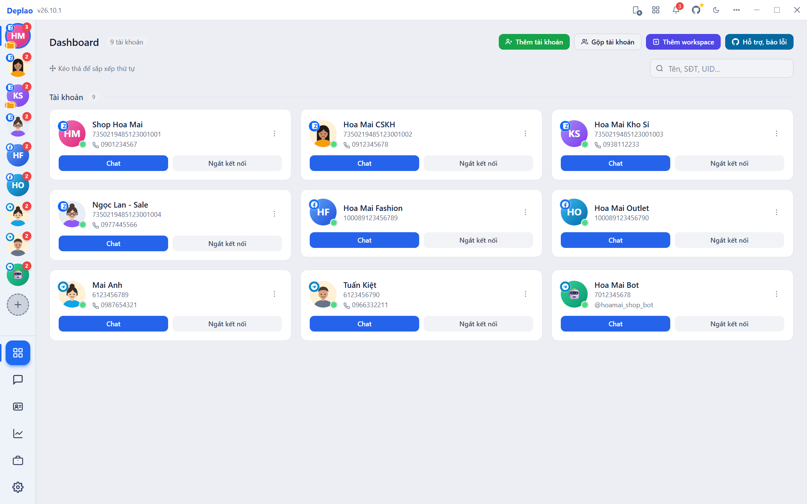
      <br />
      <sub><strong>Dashboard đa tài khoản</strong></sub>
    </td>
    <td>
      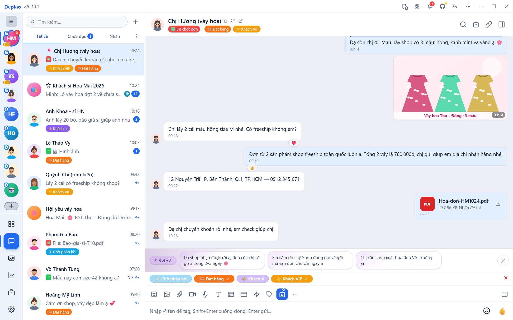
      <br />
      <sub><strong>Chat tập trung tích hợp AI gợi ý trả lời</strong></sub>
    </td>
    <td>
      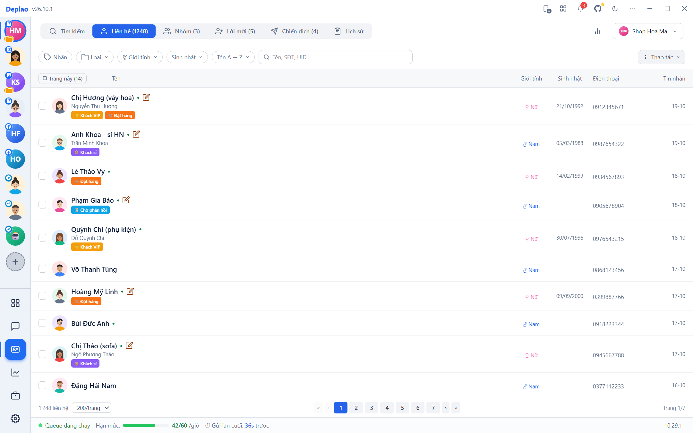
      <br />
      <sub><strong>CRM & liên hệ</strong></sub>
    </td>
  </tr>
  <tr>
    <td>
      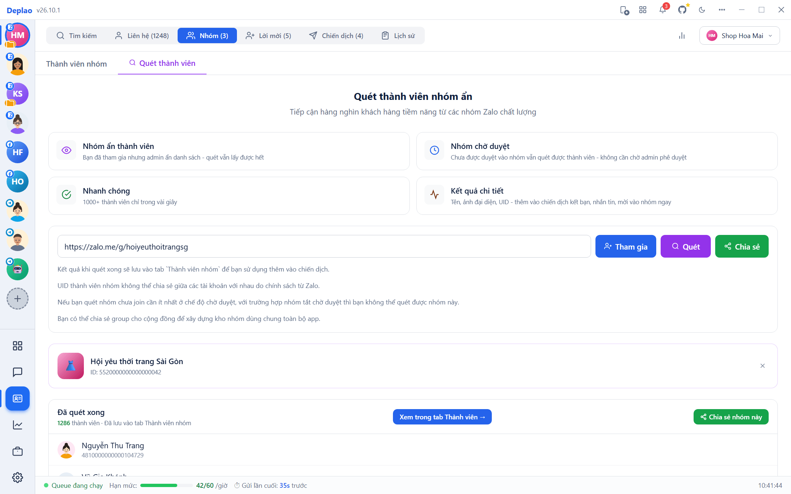
      <br />
      <sub><strong>Quét thành viên nhóm</strong></sub>
    </td>
    <td>
      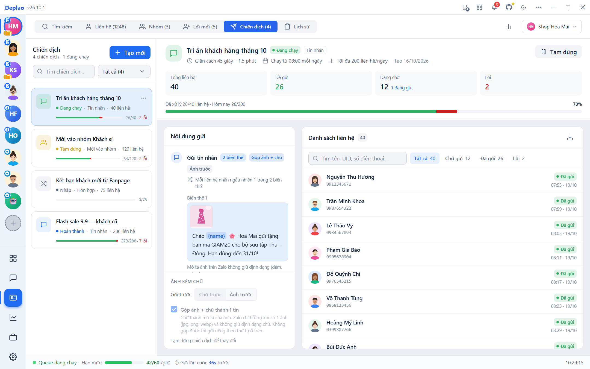
      <br />
      <sub><strong>Chiến dịch gửi tin hàng loạt</strong></sub>
    </td>
    <td>
      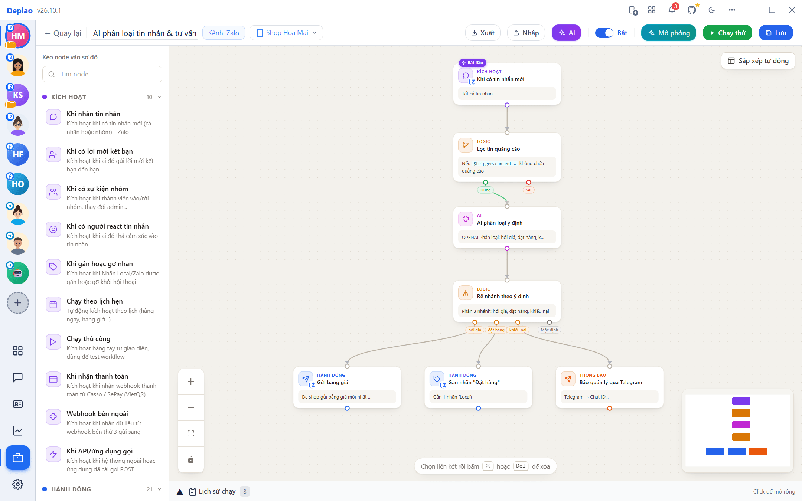
      <br />
      <sub><strong>Workflow editor</strong></sub>
    </td>
  </tr>
  <tr>
    <td>
      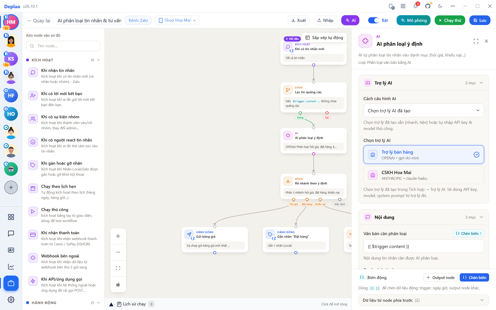
      <br />
      <sub><strong>Chi tiết workflow</strong></sub>
    </td>
    <td>
      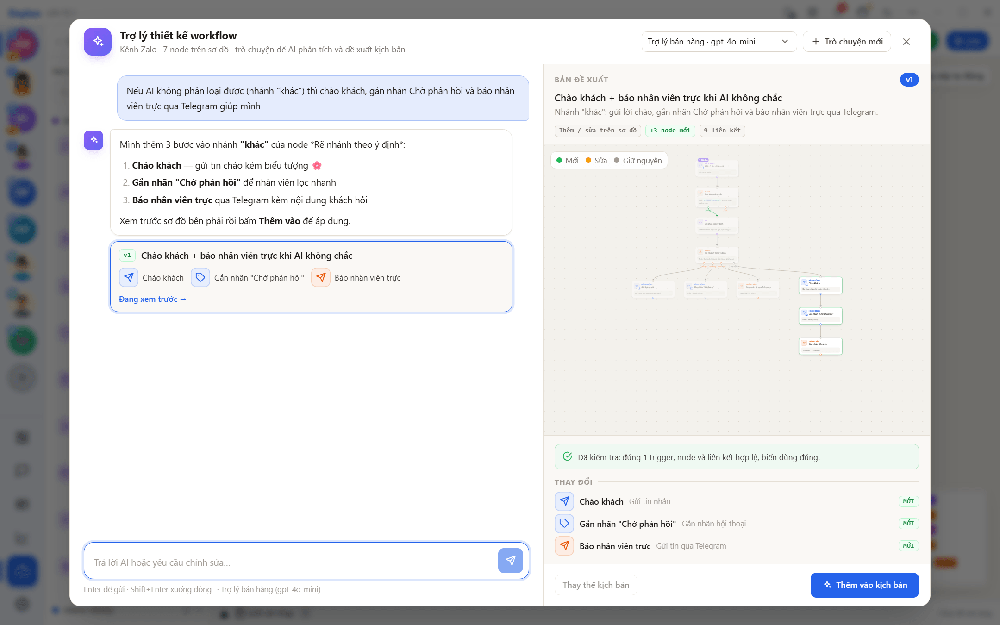
      <br />
      <sub><strong>Ra lệnh tạo Workflow bằng AI</strong></sub>
    </td>
    <td>
      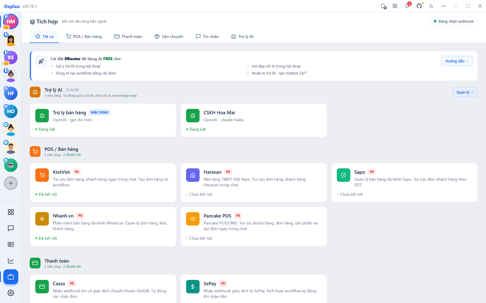
      <br />
      <sub><strong>Tích hợp POS, VC, Thanh toán</strong></sub>
    </td>
  </tr>
  <tr>
    <td>
      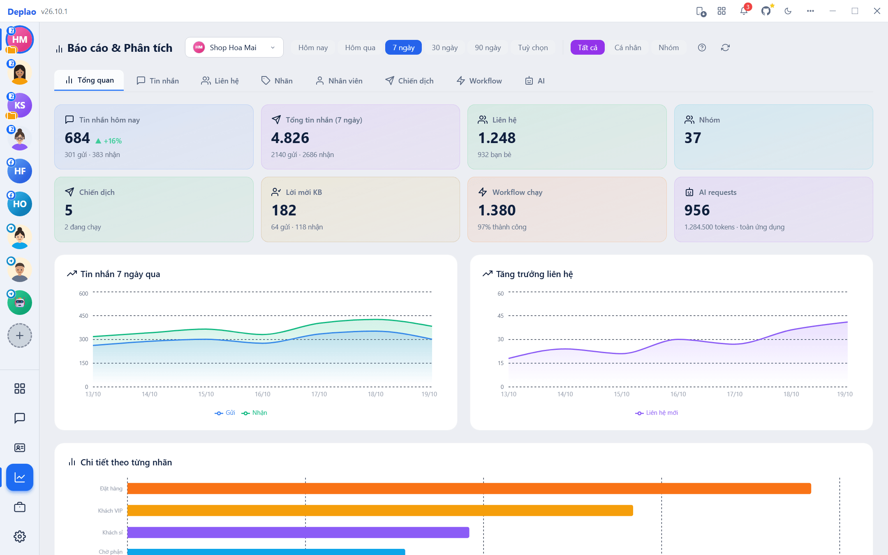
      <br />
      <sub><strong>Báo cáo & phân tích</strong></sub>
    </td>
    <td>
      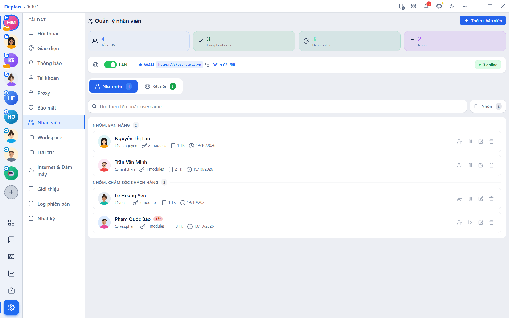
      <br />
      <sub><strong>Quản lý nhân viên</strong></sub>
    </td>
    <td>
      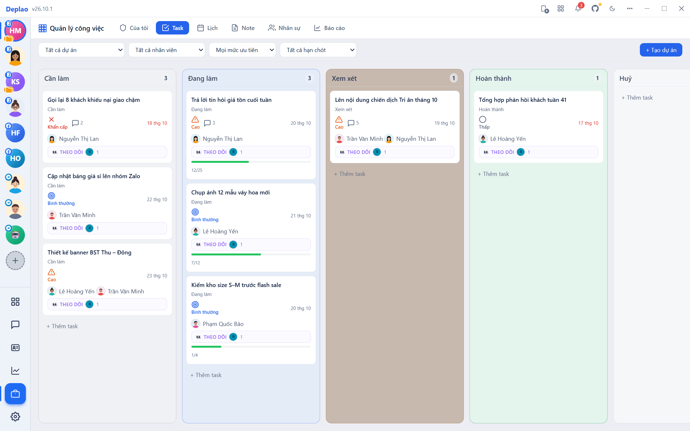
      <br />
      <sub><strong>ERP nội bộ</strong></sub>
    </td>
  </tr>
  <tr>
    <td>
      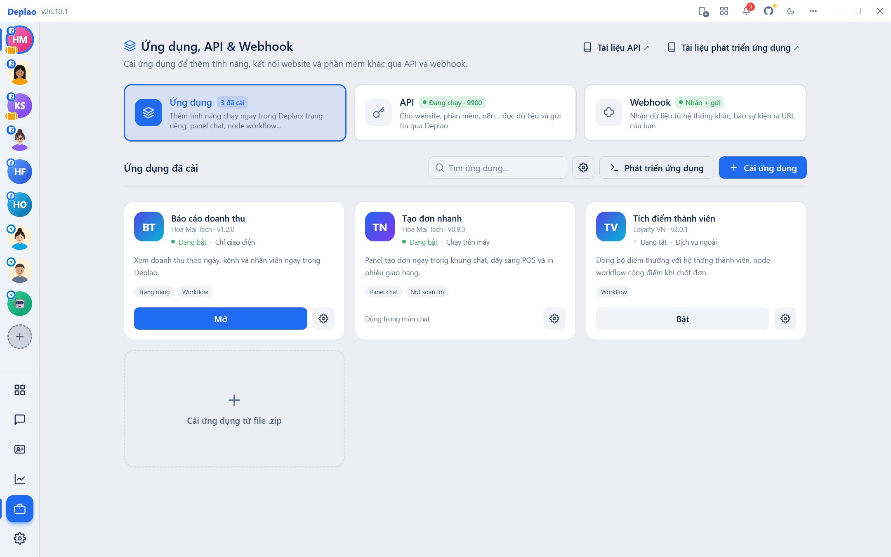
      <br />
      <sub><strong>Ứng dụng, API & Webhook</strong></sub>
    </td>
    <td>
      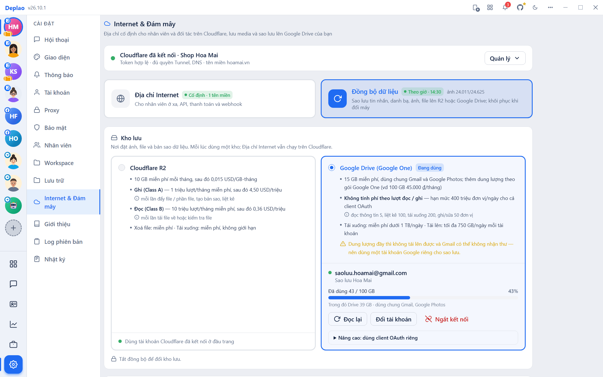
      <br />
      <sub><strong>Internet & Đám mây (Cloudflare · Google Drive)</strong></sub>
    </td>
    <td>
      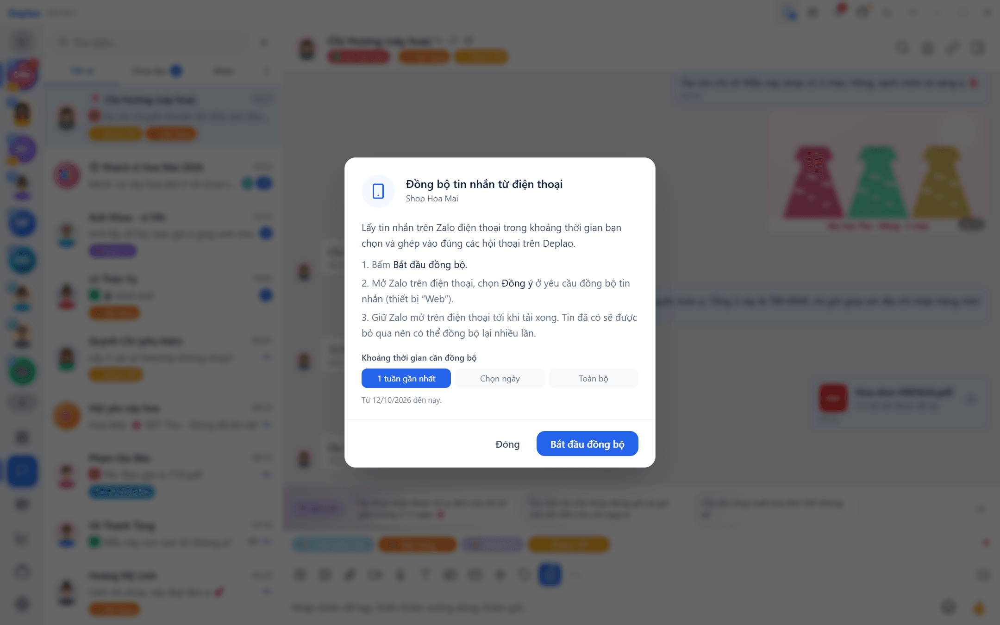
      <br />
      <sub><strong>Đồng bộ tin nhắn cũ từ điện thoại</strong></sub>
    </td>
  </tr>
</table>

## 🎯 Phù hợp với ai?

Deplao phù hợp cho:

- Shop online và đội ngũ chốt đơn qua Zalo, Facebook, Telegram
- Tự động hoá quy trình làm việc, kết hợp marketing để tìm kiếm khách hàng mới, tự động hóa chăm sóc khách hàng
- Doanh nghiệp SME cần nhiều nhân viên xử lý inbox cùng lúc
- Marketing agency hoặc freelancer quản lý nhiều tài khoản khách hàng
- Spa, phòng khám, giáo dục, F&B và các mô hình cần chăm sóc khách hàng định kỳ
- Đội nhóm muốn kết hợp chat, CRM, workflow, AI và ERP trong một desktop app duy nhất
- Đội kỹ thuật muốn nối Zalo, Facebook, Telegram vào hệ thống riêng qua API, webhook hoặc ứng dụng tự viết

<a id="tinh-nang"></a>

## 🧩 Các nhóm tính năng chính

### 1) Quản lý đa tài khoản & inbox tập trung
- Đăng nhập nhiều tài khoản Zalo (cá nhân / Business), Facebook, Telegram bot, Telegram user
- Dashboard quản lý tài khoản trực quan, đăng nhập lại Facebook ngay tại chỗ khi hết phiên
- Gộp nhiều tài khoản vào một inbox hợp nhất
- Tìm kiếm không dấu theo tên, biệt danh, số điện thoại
- Lọc nhanh theo chưa đọc, nhãn (Local / Zalo) và kênh
- Thao tác nhanh: tạo nhóm, tham gia nhóm bằng link, thêm bạn, thêm lịch hẹn và ghi chú
- Đánh dấu đã đọc hàng loạt theo khoảng thời gian của tin cuối (chạy nền), đồng bộ lên Zalo, Telegram, Facebook
- Đồng bộ tin nhắn cũ Zalo từ điện thoại theo khoảng thời gian; đồng bộ lịch sử Facebook Messenger theo tài khoản và khoảng thời gian
- Gắn Proxy riêng cho từng tài khoản

### 2) Chat đầy đủ tính năng
- Gửi tin nhắn văn bản có định dạng, ảnh, album, video, file, tin thoại
- Gửi emoji, sticker, reply, tag thành viên, thả cảm xúc
- Gửi poll, ghi chú nhóm, nhắc nhở, gửi danh thiếp
- Gửi quick messages để lưu mẫu tin và gọi nhanh bằng từ khóa
- Ghim tin nhắn không giới hạn, Tin đánh dấu, My Documents của Zalo, quản lý media và file đính kèm
- Chuyển tiếp đúng mọi loại tin Zalo, mốc ngày khi cuộn, xem bộ sưu tập ảnh
- Telegram: tạo nhóm / kênh, quản lý nhóm / kênh, danh bạ, nhật ký cuộc gọi, bảng Sticker · GIF đồng bộ tài khoản

### 3) CRM & chăm sóc khách hàng
- Đồng bộ bạn bè, thành viên nhóm và hồ sơ liên hệ
- Quét thành viên nhóm Zalo theo link, kể cả nhóm ẩn danh sách thành viên hoặc nhóm đang chờ duyệt; kết quả lưu vào CRM để kết bạn, nhắn tin, mời vào nhóm
- Lưu số điện thoại, giới tính, ngày sinh, ghi chú nội bộ
- Tạo và quản lý nhãn Zalo hai chiều, nhãn Local dùng chung nhiều tài khoản
- Lọc liên hệ theo nhiều tiêu chí để chăm sóc đúng nhóm khách hàng
- Tạo campaign gửi tin, kết bạn, mời vào nhóm với tiến độ realtime; xem trước nội dung như khung chat, tuỳ chọn gửi ảnh trước / chữ trước hoặc gộp ảnh + chữ

### 4) Workflow tự động hóa
- Workflow kéo-thả không cần code, sơ đồ có nút sắp xếp tự động
- AI copilot dạng chat để tạo và sửa workflow bằng câu lệnh (xem mục 7)
- Chế độ Mô phỏng chạy thử không gửi tin thật
- Hỗ trợ trigger từ tin nhắn, nhãn, react, lịch cron, sự kiện nhóm, thanh toán, đơn hàng từ phần mềm bán hàng, webhook...; lọc theo vai trò người gửi, chỉ khi được @nhắc
- Action gửi tin, gửi ảnh/file, tìm user, quản lý nhóm, mute, forward, recall...
- Tích hợp logic, Google Sheets, AI, Telegram, Email, Notion và HTTP Request
- Có lịch sử chạy để kiểm tra và debug dễ dàng

### 5) Tích hợp phục vụ bán hàng
- POS: KiotViet, Haravan, Sapo, Nhanh.vn, Pancake POS — tra cứu, tạo đơn ngay trong hội thoại; webhook đơn hàng / khách hàng (xác thực bằng khoá) tự chạy workflow
- Vận chuyển: GHN, GHTK
- Thanh toán: Sepay, Casso
- AI Assistant gợi ý trả lời, hỏi đáp trực tiếp trong hội thoại (xem mục 7)
- Dễ kết hợp thành quy trình bán hàng và chăm sóc khách hàng khép kín

### 6) Báo cáo, ERP và nhân viên
- Báo cáo tin nhắn, liên hệ, chiến dịch, workflow, AI, nhân viên
- ERP nội bộ gồm Task, Calendar, Notes
- Mô hình boss ↔ nhân viên và phân quyền module, nhân viên chỉ thấy tài khoản được giao
- Nhân viên kết nối qua LAN hoặc Internet, tự kết nối lại, đồng bộ realtime cả sửa / xoá / cảm xúc
- Hỗ trợ theo dõi hiệu suất làm việc theo từng người và từng giai đoạn

### 7) 🤖 Trợ lý AI (AI Assistant)
- Gợi ý trả lời thông minh trong hội thoại
- Hỏi đáp trực tiếp với AI ngay trong khung chat
- Tạo và sửa workflow tự động bằng câu lệnh tiếng Việt qua AI copilot, không cần kéo-thả
- Dùng node AI trong workflow để xây dựng chatbot trả lời tự động 24/7
- Hỗ trợ đa nền tảng AI: OpenAI, Claude, Gemini, Deepseek, Grok,... và các AI gateway local như 9Router, OpenRouter, v.v.

### 8) 🧩 Ứng dụng, Public API & Webhook
- Public API v1 gần 300 thao tác, API key theo quyền / tài khoản / IP / hạn dùng, nhật ký request
- Sự kiện realtime và webhook gửi ra có chữ ký, trang tài liệu + OpenAPI
- Cài và tự viết ứng dụng chạy ngay trong Deplao, có SDK và CLI (xem mục [Public API](#public-api))

### 9) ☁️ Internet & Đám mây (Cloudflare · Google Drive)
- Một chỗ cấu hình địa chỉ Internet (địa chỉ tạm, Cloudflare tự động, ngrok, Cloudflare thủ công) cho nhân viên ở xa, webhook và thanh toán
- Chọn kho lưu: Cloudflare R2 hoặc Google Drive (Google One) — đăng nhập Google trên trình duyệt, Deplao chỉ thấy file do chính nó tạo
- Lưu media lên kho đã chọn, tự lấy lại khi file trên máy thiếu, tuỳ chọn giải phóng ổ đĩa
- Sao lưu & đồng bộ DB lên kho đã chọn, mã hoá ngay trên máy; khôi phục sang máy mới hoặc máy dự phòng
- Mức sử dụng & chi phí: % phần miễn phí và ngưỡng tính phí, phí ước tính tháng này (R2), giải thích Ghi / Đọc / Tải xuống

<a id="bao-mat"></a>

## 🔒 Bảo mật & dữ liệu

Deplao ưu tiên kiến trúc chạy cục bộ trên máy người dùng:

- Tất cả dữ liệu tin nhắn, danh bạ, CRM, cài đặt và media được lưu trên máy
- Đăng nhập Zalo bằng QR Code, không lưu mật khẩu; phiên đăng nhập (cookie, token) chỉ lưu trên máy và được mã hoá bằng khoá của hệ điều hành (phiên Zalo, Telegram, token bot, cookie Facebook)
- Người dùng có thể đổi thư mục lưu trữ dữ liệu sang ổ đĩa khác khi cần
- Đám mây là tuỳ chọn và dùng tài khoản Cloudflare / Google của chính bạn (với Google Drive, Deplao chỉ được quyền với file do chính nó tạo); bản sao lưu DB được mã hoá trên máy trước khi tải lên
- Public API tắt sẵn, API key giới hạn theo quyền, tài khoản, IP; ứng dụng chỉ chạy trong phạm vi quyền đã duyệt
- Nhân viên chỉ truy cập được tài khoản được giao; khoá hoặc đổi mật khẩu nhân viên là thu hồi phiên ngay
- Phù hợp với đội nhóm muốn kiểm soát dữ liệu nội bộ chặt chẽ hơn
- Deplao là công cụ quản lý tài khoản của chính bạn: hãy tuân thủ điều khoản của Zalo, Facebook, Telegram và quy định về bảo vệ dữ liệu cá nhân, không dùng để gửi tin rác hay thu thập dữ liệu trái phép

## 💻 Yêu cầu vận hành

- Kết nối Internet 24/7 ổn định để đồng bộ hội thoại và automation
- Nên để app hoạt động liên tục nếu dùng workflow hoặc vận hành đội nhóm


---------------------------------------------------------------------------------------------------------------------------------------------

<a id="lien-he"></a>

## 📣 Liên hệ

- Báo lỗi, góp ý hoặc cần hỗ trợ: 👉 [Tạo issue tại đây](https://github.com/babyvibe/deplao-builder/issues)

## 🙏 Lời cảm ơn

Deplao xin gửi lời cảm ơn đến các dự án: zca-js, fbchat-v2 (mautrix-meta) & GramJS.

---

<a id="giay-phep"></a>

## 📝 Giấy phép

Dự án được phân phối dưới giấy phép **MIT**.
Xem file [LICENSE](LICENSE) để biết thêm chi tiết.

---
